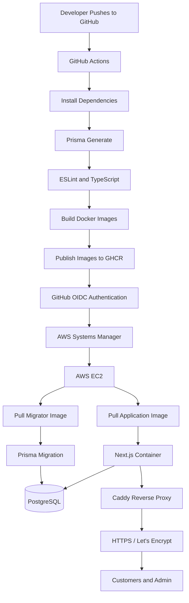

# RUBYS — AWS DevOps Deployment Project

**Automated CI/CD deployment of a containerized Next.js e-commerce application to AWS EC2 using Terraform, Docker Compose, GitHub Actions, GitHub Container Registry and AWS Systems Manager.**

[](https://github.com/Musty2025x/rubys-store/actions/workflows/ci-cd.yml)

**Live application:** https://rubys.mustydevops.com.ng
**Repository:** https://github.com/Musty2025x/rubys-store

---

## 1. Project Overview

RUBYS is a premium organic African haircare e-commerce platform. This project demonstrates how to provision cloud infrastructure, containerize a full-stack application, automate image builds and deploy application updates securely to AWS.

The deployment pipeline is designed to reduce manual intervention, maintain persistent database storage and support repeatable application releases.

### Project objectives

- Provision AWS infrastructure using Terraform.
- Containerize the Next.js application and supporting database tooling.
- Build and publish Docker images automatically.
- Implement CI/CD with GitHub Actions.
- Authenticate GitHub Actions to AWS using OpenID Connect (OIDC).
- Execute remote deployment commands through AWS Systems Manager.
- Apply Prisma database migrations during deployments.
- Serve the application over HTTPS.
- Keep PostgreSQL inaccessible directly from the public internet.

## 2. Technology Stack

| Area | Technology |
|---|---|
| Application | Next.js, React, TypeScript |
| Runtime | Node.js 22 |
| Database | PostgreSQL 17 |
| ORM | Prisma |
| Cloud provider | AWS |
| Infrastructure as Code | Terraform |
| Compute | Amazon EC2 |
| Operating system | Ubuntu 24.04 |
| Containerization | Docker |
| Container orchestration | Docker Compose |
| Image registry | GitHub Container Registry |
| CI/CD | GitHub Actions |
| Cloud authentication | AWS IAM OIDC |
| Remote deployment | AWS Systems Manager |
| Reverse proxy | Caddy |
| TLS | Let's Encrypt |
| Domain | rubys.mustydevops.com.ng |

## 3. System Architecture

The application follows a container-based deployment architecture.

### CI/CD workflow

1. A developer pushes code to the `main` branch.
2. GitHub Actions checks out the repository.
3. Dependencies are installed and Prisma Client is generated.
4. ESLint and TypeScript checks are executed.
5. Docker Buildx builds the application, migrator and seeder images.
6. Images are published to GitHub Container Registry.
7. GitHub Actions authenticates to AWS through OIDC.
8. AWS Systems Manager sends the deployment command to EC2.
9. EC2 pulls the application and migrator images for the exact Git commit.
10. Prisma migrations are applied.
11. The Next.js application and Caddy are started or updated.
12. An HTTPS health check verifies the deployment.

### Architecture diagram



## 4. AWS Infrastructure

The infrastructure is provisioned and managed using Terraform.

| Resource | Configuration |
|---|---|
| AWS Region | us-east-1 |
| EC2 instance | t3.small |
| Operating system | Ubuntu 24.04 |
| Root storage | 20 GB encrypted gp3 |
| Public addressing | Elastic IP |
| Instance access | AWS Systems Manager |
| IAM instance role | AmazonSSMManagedInstanceCore |
| Security group | Restricted SSH, public HTTP/HTTPS |
| Domain | rubys.mustydevops.com.ng |

### Network security

The security group allows:

- TCP 22 — SSH from an authorised IP address.
- TCP 80 — HTTP traffic for web access and certificate management.
- TCP 443 — HTTPS traffic.

PostgreSQL port 5432 and Next.js port 3000 are not exposed through public inbound security group rules.

The application and database communicate over a private Docker network.

## 5. Container Architecture

Docker Compose manages the application services on EC2.

| Container | Purpose |
|---|---|
| rubys-app | Next.js application |
| rubys-postgres | PostgreSQL database |
| rubys-caddy | Reverse proxy and HTTPS |
| Migrator | Applies Prisma database migrations |
| Seeder | Populates initial product catalogue data |

### Persistent storage

PostgreSQL uses a named Docker volume:

`rubys_postgres_data`

This keeps database data separate from the application container lifecycle.

The database is not exposed directly to the internet.

### Application images

Images are published to GitHub Container Registry:

- `ghcr.io/musty2025x/rubys-store`
- `ghcr.io/musty2025x/rubys-store-migrator`
- `ghcr.io/musty2025x/rubys-store-seeder`

Application and migrator deployment images use full Git commit SHA tags so that a deployment can identify the exact source revision.

The seeder image is built and published separately. Product seeding is not part of every deployment.

## 6. CI/CD Pipeline

The pipeline is defined in:

`.github/workflows/ci-cd.yml`

### Build and validation stage

- Checkout source code.
- Set up Node.js 22.
- Install dependencies with `npm ci`.
- Generate Prisma Client.
- Run ESLint.
- Run TypeScript type checking.
- Build Docker images using Docker Buildx.
- Publish images to GHCR.

### Deployment stage

The deployment job runs only after a successful build on pushes to `main`.

It uses:

- GitHub Actions OIDC.
- AWS IAM role assumption.
- AWS Systems Manager Run Command.
- Docker Compose.
- Prisma Migrate Deploy.
- HTTPS health checks.

### Deployment sequence

```bash
docker compose -f docker-compose.ec2.yml pull app migrator

docker compose -f docker-compose.ec2.yml \
  --profile migration run --rm migrator

docker compose -f docker-compose.ec2.yml up -d app caddy
```

The deployment script also checks the public HTTPS endpoint and reports a failure if the application does not become healthy within the configured retry period.

## 7. Security Implementation

Security is an important part of this project.

### GitHub OIDC

GitHub Actions assumes a dedicated IAM deployment role through OIDC.

This avoids storing permanent AWS access keys in GitHub repository secrets.

The IAM trust policy restricts access to the intended GitHub repository and `main` branch identity.

### Least privilege

The GitHub deployment role is granted permissions for:

- Sending SSM commands to the designated EC2 instance.
- Retrieving SSM command execution results.

The EC2 instance has its own IAM role for Systems Manager connectivity.

### Secrets management

Application secrets are maintained in protected EC2 environment files and are not committed to the Git repository.

Examples include:

- Database connection strings.
- Authentication secret.
- Administrator password hash.
- Cron secret.

Never commit `.env` files, Terraform state files, private keys or credentials.

## 8. Repository Structure

```text
rubys-store/
│
├── .github/
│   └── workflows/
│       └── ci-cd.yml
│
├── prisma/
│   ├── migrations/
│   ├── schema.prisma
│   └── seed.ts
│
├── src/
│   ├── app/
│   ├── components/
│   ├── context/
│   ├── data/
│   └── lib/
│
├── terraform/
│   └── environments/
│       └── dev/
│           ├── main.tf
│           ├── providers.tf
│           ├── variables.tf
│           ├── outputs.tf
│           ├── security.tf
│           ├── iam.tf
│           ├── github-oidc.tf
│           └── user-data.sh
│
├── Dockerfile
├── docker-compose.yml
├── package.json
├── prisma.config.ts
└── README.md
```

The EC2 deployment files are maintained separately on the server in `~/rubys-deployment`.

## 9. Deployment Verification

The live deployment has been verified through the GitHub Actions workflow.

Confirmed results include:

- Successful GitHub OIDC authentication.
- Successful AWS SSM command execution.
- Successful application and migrator image pulls.
- Successful Prisma migration execution.
- Successful application restart.
- Successful HTTPS health check.

The migration command reported:

```text
5 migrations found in prisma/migrations

No pending migrations to apply.
```

Live application:

https://rubys.mustydevops.com.ng

## 10. Operational Commands

Connect to EC2:

```bash
ssh -i ~/.ssh/rubys-ec2-key.pem \
  ubuntu@YOUR_EC2_PUBLIC_IP
```

Navigate to deployment directory:

```bash
cd ~/rubys-deployment
```

View running containers:

```bash
docker compose -f docker-compose.ec2.yml ps
```

View application logs:

```bash
docker logs -f rubys-app
```

View PostgreSQL logs:

```bash
docker logs -f rubys-postgres
```

View Caddy logs:

```bash
docker logs -f rubys-caddy
```

Check application HTTPS:

```bash
curl -I https://rubys.mustydevops.com.ng
```

Validate Compose configuration:

```bash
docker compose -f docker-compose.ec2.yml config --quiet
```

**Database safety:** Never use `docker compose down -v`, `prisma migrate reset` or destructive database commands on the production deployment. Protect the PostgreSQL volume and maintain verified backups.

## 11. Future Improvements

Potential next improvements include:

- Automated database backups and restore testing.
- CloudWatch metrics, logs and alarms.
- Container and dependency vulnerability scanning.
- Automated rollback to a previously deployed image.
- Application integration and end-to-end tests.
- Improved deployment concurrency and release controls.
- Centralised secrets management using AWS Secrets Manager.
- Infrastructure monitoring and cost optimisation.
- Deployment notifications.

These are planned improvements, not features claimed as already implemented.

## 12. Key DevOps Skills Demonstrated

This project demonstrates practical experience with:

- AWS infrastructure provisioning using Terraform.
- IAM roles and least-privilege access.
- GitHub Actions CI/CD.
- GitHub OIDC authentication.
- AWS Systems Manager.
- Docker multi-stage builds.
- Docker Compose deployments.
- GitHub Container Registry.
- PostgreSQL container persistence.
- Prisma database migrations.
- Reverse proxy configuration and HTTPS.
- Production deployment troubleshooting.

---

**Project:** RUBYS — AWS DevOps Deployment

**Repository:** https://github.com/Musty2025x/rubys-store

**Live URL:** https://rubys.mustydevops.com.ng

*Built as a practical cloud infrastructure and DevOps portfolio project.*